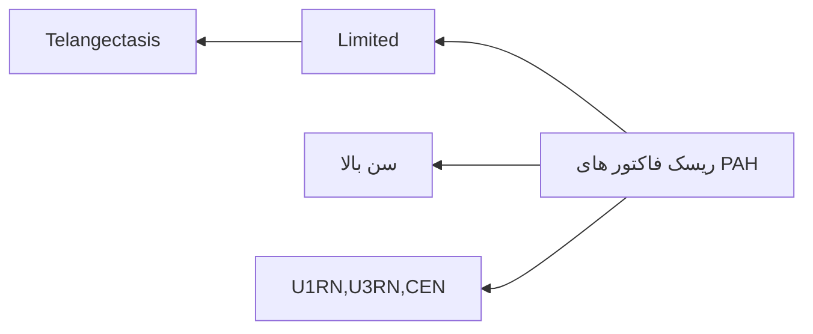
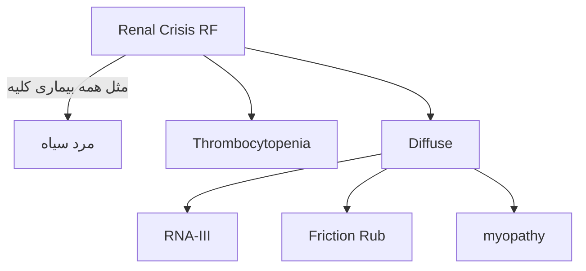

# Rheumatology
# Vasculitis

| بیماری |                    عارضه تنفسی                     |               عارضه کلیوی               |                        عارضه چشمی - عصبی                         |       عارضه پوستی        |        عارضه قلبی         |                                      دیگه چی                                       |
| :----: | :------------------------------------------------: | :-------------------------------------: | :--------------------------------------------------------------: | :----------------------: | :-----------------------: | :--------------------------------------------------------------------------------: |
|  GPA   | ==کاویته و اینفلتره<br><br>سینوزیت های خونی چرکی== |           آسیمپوتوماتیک تا GN           | منونوریت مولتیپلکس - سورال <br>267<br><br>بیرون زدگی چشم و کنژنک |       پتشی پورپورا       |         پریکاردیت         | **==Strawberry Gum==**<br><br>$Plt \uparrow$<br>$RBC \downarrow$<br>$WBC \uparrow$ |
|  EGPA  |        آسم و پنومونی<br><br>==Nasal Polyp==        |                   GN                    |                                                                  |                          | HF و Pericardial Effusion |            ==واسکولیت نکروزان==<br><br>$Eosinophil > 1000-1500 (10\%)$             |
|  MPA   |            **==Alveolar haemorrhage==**            |              **==RPGN==**               |                                                                  |         پورپورا          |                           |                   تب غیر قابل <br>توضیح<br><br>==بدون گرانلوم==                    |
|  PAN   |             **==بدون هیچ عارضه ای==**              | ==بدون GN==<br>هایپرتنشن و میکروآنوریسم |                        منونوریت مولتیپلکس                        | **==Digital Gangrene==** |                           |                         **==سرونگاتیو<br> بدون گرانلوم==**                         |

# Scleroderma

**==همه این نکات و نمودار ها سواله==**



 **بیشترین اسکور تشخیصی**:
1. **==MCP==** Scleroderma : 9 Score
2. **==Sclerodactyly==** : 4 Score

| TARGET ANTIGEN                                                    | PROMINENT CHARACTERISTIC CLINICAL ASSOCIATION                                                                                                                    |
| ----------------------------------------------------------------- | ---------------------------------------------------------------------------------------------------------------------------------------------------------------- |
| **DNA Topoisomerase I (Scl-70)**<br>Speckled pattern              | ==**Tendon friction rubs**==, digital ischemic ulcers, scleroderma, extensive skin involvement, **==early ILD==**, cardiac involvement, scleroderma renal crisis |
| **Centromere proteins**<br>Discreet speckled (centromere) pattern | ==Digital ischemic ulcers, calcinosis cutis, isolated PAH==; renal crisis rare                                                                                   |
| **RNA polymerase III**<br>Speckled pattern                        | Rapidly progressive skin, tendon friction rubs, joint contractures, **==GAVE==**, **==renal crisis==**, contemporaneous **==cancers==**; digital ulcers rare     |
| U3-RNP (fibrillarin)<br>Nucleolar pattern                         | **==PAH==**, **==ILD==**, scleroderma renal crisis, GI tract involvement, myositis                                                                               |
| Th/T₀<br>Nucleolar pattern                                        | ILD, PAH                                                                                                                                                         |
| PM/Scl<br>Nucleolar pattern                                       | Calcinosis cutis, ILD, **==myositis overlap==**                                                                                                                  |
| Ku<br>Speckled pattern                                            | SLE, myositis overlap                                                                                                                                            |
| U1-RNP<br>Speckled pattern                                        | PAH, inflammatory arthritis, myositis overlap                                                                                                                    |
| U12 RNP<br>Speckled pattern                                       | ILD                                                                                                                                                              |
# OA
## نکات امتحان
1. بر خلاف نقرس و RA، در مایع مفصلی **==WBC<2000==** 
2. **==سن==** قوی ترین ریسک فاکتور استئوآرتریت - بعدش چاقی و ==زن==
3. هیچ آزمایش و بیومارکری نداره
4. ```mermaid
   graph RL
   A[مواد موجود در غضروف]
   A -- مقاومت در کشش --> کلاژن
   A -- مقاومت در برابر فشردگی --> اگرکان
   ```
5. استئوآرتیت ==دست== بیشترین نقش ==ژنتیک== وجود داره
6. عوامل ساخت استئوفیت : **==$TGF\beta$ و BMP-2==**
7. واسکولار اینویژن از استخوان شروع میشه
![[Pasted image 20261103185651.png]]
8. ==شایع ترین== علامت OA : ==درد== 
9. ```mermaid
   graph RL
   A[مثبت شدن RF]
   A --> B[اندوکاردیت عفونی]
   A --> __[بیماری های مزمن کبدی]
   A --> _[شوگرن اولیه]
   ```
# Myositis
|    بیماری/آنتی بادی     |                                     هالمارک                                      |  سرطان   |                                        ریوی                                        |           پوستی            |       قلبی       |                 پروگنوز                  |
| :---------------------: | :------------------------------------------------------------------------------: | :------: | :--------------------------------------------------------------------------------: | :------------------------: | :--------------: | :--------------------------------------: |
| ==درماتومیوزیت کلاسیک== |        گوترن<br>Shall sign<br>V sign<br>هلیوتروپ<br>Subcutanous $Ca^{+2}$        | ==دارد== |                                                                                    |                            |                  |                                          |
|        Anti-Mi-2        |                                                                                  |          |                                                                                    |        Florid rash         |                  |             حاد<br>بسیار خوب             |
|       Anti-MDA-5        |                              **==Amyopathic DM==**                               |          |                          ==**Rapidly progressive ILD**==                           | راش پالمار - اولسر- ایسکمی |                  |                10-20%<br>                |
|    Anti-TIF1$\gamma$    |                                   بشدت اختصاصی                                   | ==دارد== |                                                                                    |                            |                  |                                          |
|        Anti-NXP2        |                                     دیسفاژی                                      | ==دارد== |                                                                                    |   ادم زیرپوستی و کلسینوز   |                  |                   17%                    |
|        Anti-SAE         |                                     CK نرمال                                     | ==دارد== |                                    بله ولی mild                                    |        فقط اسکین رش        |                  |                   1-8%                   |
|        ==Asys==         |                                                                                  |          |                                                                                    |                            |                  |                                          |
|          JO-1           |                              دست مکانیکی<br>آرتریت                               |          | ==**Rapidly progressive ILD**== (بد تر از بقیه)<br><br>*میتونه هم بشدت پنهان باشه* |  ==رینود==<br>دست مکانیکی  |                  |                                          |
|        ==IMNEM==        |                                                                                  |          |                                                                                    |                            |                  | خستگی پروگزیمال ساب اکیوت و CK بشدت بالا |
|       Anti-HMGCR        |                مربوط به آترواستاتین<br><br>==نکروز== *2 بار سوال*                |          |                                                                                    |                            |                  |                                          |
|        Anti-SRP         |                                     دیسفاژی                                      | ==دارد== |                                                                                    |                            |  درگیری میوکارد  |                                          |
|         ==IBM==         |                    ==ضعف عضلات دیستال==<br><br>Inclusion Body                    |          |                                                                                    |                            |                  |                پیشرفت کند                |
|        Anti-cN1A        | ضعف فلکسور دست و اکستنسور پا<br>عضلات صورت و چشم<br>CK پایین<br><br>==آسیمتریک== |          |                                                                                    |                            |                  |          همین هیچ پوستی نداشتن           |
|    ==Polymyositis==     |                                                                                  | ==دارد== |                                   مشکل ریوی داره                                   |                            | درگیری قلبی داره |               پروگنوز خوب                |


|                              | Dermatomyositis (DM)                                                   | Polymyositis (PM)                                         |
| :--------------------------- | :--------------------------------------------------------------------- | :-------------------------------------------------------- |
| **Primary Target Structure** | Endomysial & perimysial capillaries (**==vascular==**)                 | **==cellular==**                                          |
| **Predominant Infiltrate**   | **==CD4+ T cells==**, B cells, Plasmacytoid DCs, Macrophages           | **==CD8+ Cytotoxi==**c T cells, Macrophages               |
| **Histological Pattern**     | Perivascular / Perimysial; **==Perifascicular atrophy==** *سوال بوده!* | Endomysial; Non-necrotic myofiber invasion                |
| **Complement Activation**    | Yes                                                                    | Minimal / Not a primary driver                            |
| **Molecular Signature**      | Strong **==Type I Interferon==** (IFN-α/β) upregulation                | **==MHC Class I==** (HLA-ABC) antigen presentation & CTLs |
| **Specific Autoantibodies**  | Anti-Mi-2, Anti-NXP2, Anti-TIF1-γ, Anti-MDA5                           | —                                                         |
**Irritable Myopathy** : low amplitude, high voltage, spontaneous fibrillation
وجه افتراق IBM و IMNEM در بالین ==**میزان CK**== عه!
تنها تشخیص افتراقی که **CK رو بالا** می بره : **==Hypothyroidism==** 

## نکات نمونه ها 
1. تشخیص افتراقی ویروس ها **==Influenza, HTLV1, Covid19==** 
2. اگرچه بخوایم دقیق بگیم ==Amyopathic== میشه MDA-5 که شانس کنسر نداره اما باز باید ==غربالگری کنسر== بکنیم
3. میتونه با **==شوگرن==** مربوط باشه *هعپ*
4. مارکر **==ALP==** ارتباطی با ماهیچه ها **==نداره==** 
5. جز مکانیسم اصلی درگیری مفاصل **==هیدروکسی آپاتیته==** *(همین ==2بار== سوال بوده)* 
# Spondyloarthropathy

## نکات نمونه سوال ها

1. **میزان همراهی با HLA-B27**

|  درگیری   | درصد HLA-B27 مثبت |            همراهی خاص            |
| :-------: | :---------------: | :------------------------------: |
|  r-axSpA  |        92%        |     ==همراهی با درگیری چشم==     |
| nr-axSpA  |        75%        |                                  |
|   JSpA    |        75%        |           قبل 16 سالگی           |
|    ReA    |        70%        | پروگنوز بد و ==مزمن شدن بیماری== |
| Axial PsA |        65%        |                                  |
| Axial IBD |        60%        |                                  |
|    PsA    |        20%        |                                  |
|    IBD    |        10%        |                                  |
|   SAPHO   |        0%         |                                  |
|   DISH    |        0%         |                                  |
2. در ==IBD== درگیری ==محیطی مربوط== به تغییرات گوارشیه اما ==**مرکزی نه**== 
3. اولین علامت ساکروالئیت : ==ادم مغر استخوان== 
4. **اروسیو بودن آرتریت ها**

| آرتریت اروسیو | آرتریت غیر اروسیو |
| :-----------: | :---------------: |
|      RA       |      ==IBD==      |
|      AS       |        SLE        |
|      PsA      |      Sjögren      |
|    Septic     |    Scleroderma    |
|               |      Behcet       |
4. بیماری **SAPHO** میشه Synovitis, Acne, Pustulosis, Hyper-osteosis, Osteitis و 8% با ==IBD همراهی== داره
5. کاراکتریستیک ==PsA== ، ==انگشتان تلسکوپیه== ! *بقیه چیزا مثل داکیتلیت و آنتزیت اختصاصی نیست*
6. در SA بر خلاف RA، ==سینویت ها آوسکولار== هستند! *جواب سوال بود*
7. در مراحل **پیشرفته** SA، چیزی که زیاد میشه  $TGF\beta$ عه
8. شایعترین درگیری ==خارج مفصلی== در SpA میشه ==Uveitis== *نه IDL*. *==همین 2 بار سوال==*
9. ==50%== بیماران nr-AxSpA تبدیل به رادیوگرافیک می شن
10. در زنان ==**آرتریت محیطی و انتزیت - درگیری اسپاین**== بیشتر از مردانه
11. از این عکس **==بارها سوال==** اومده:
![[Pasted image 20261103152258.png]]
12. ==Anti IL-17== is contraindicated in ==IBD== and **Anti IL-23** in **Axial** 
13. سایتوکاین ==TNF-alpha== سایتوکاین اصلی همه اسپاندیلو هاست
14. HLA-B27 is on ==MHC Class I==, in contrast to **HLA-DRB1** which on **MHC Class II**
15. ```mermaid
    graph LR
    A[Difinitive sacroiliitis] --> _[Grade 2 BILATERAL]
    A --> __[Grade 3 or 4]
    ```
16. درگیری ساکروایلیال در ==ReA== معمولا ==Unilateral== عه! برخلاف SA
17. در 5 تا 10 درصد موارد ممکن است در ==PsA== تیتر ==RF+ و CCP+== باشه!
18. فاکتور های ESR و CRP فقط در ==30%== موارد ReA مثبت میشه! (*نه RA*)
19. نوع **==PsA==** میتونه **==پلی آرتریت قرینه==** بده که خوره تشخیص افتراقی با AR عه

|                   |    یووئیت در اسپوندیلیت آنکیلوزان (AS)    | یووئیت در آرتریک پسوریاتیک (PsA) |
| :---------------: | :---------------------------------------: | :------------------------------: |
|     **شیوع**      |       شایع‌ترین تظاهر خارج مفصلی AS       |        شیوع ۷ تا ۳۳ درصد         |
|  **محل درگیری**   |               یووئیت قدامی                |       ==**یووئیت خلفی**==        |
|  **سمت درگیری**   |              معمولاً یک‌طرفه              |      ==**معمولاً دوطرفه**==      |
|   **زمان شروع**   |     ممکن است اولین تظاهر بیماری باشد      |               مزمن               |
|  **علائم همراه**  |            درد، قرمزی، فتوفوبی            |   تمایل به کوری، پروگنوز بدتر    |
| **پاسخ به درمان** | اغلب به کورتیکواستروئید موضعی پاسخ می‌دهد |       پاسخ سخت‌تر به درمان       |
19. شایعترین تظاهر دهانی در==ReA== ، ==ضایعات پوستی مخاطیه== : *سوال گفته بود ممکنه فرد ReA زخم دهانی بدون درد داشته باشه که میشه درست*
20. در ==PsA== سطح اوریک اسید میتونه بالا بره که به ==نقرس== بیانجامد!
21. ==**اسکلروز ساب کندرال**== در ==OA== دیده میشه نه RA! 
22. ==ساکروایلیاک + تنفسی== = PsA *(کلا هر سوالی رادیوگرافی لگن داشت بزن)*
23. **==علائم رادیولوژیک AS**==
24. اسپونیدلوآرتروپاتی پاسخ دراماتیک به **==NSAID==** داره
    ```mermaid 
    graph LR
    A[AS] -- از جلو می خوره --> A1[مربعی شدن مهره ها]
    A -- در مراحل اولیه --> A2[درخشان شدن گوشه مهره ها]
    A -- پیشرفته --> A3[سین دسموفیت و بامبو اسپاین]
    A -- ناشایع --> A4[Spondylodiscitis]
    ```
25. صرف HLA-B27 مثبت شدن، شانس بیماری میشه ==20%== 
26. درگیری ==ناخن== در PsA معمولا ==قبل== از علائم SpA رخ میده *2 بار سوال!*
27. عارضه ==JSpA== در ==پسر== ها بیشتر
28. ==آرتریت ریکتیو== کلا ==**سرونگاتیو**== عه!
29. کلا اسپاندیلو مفاصل هیپ، زانو، شونه رو میگیره
30. ==مداد در فنجان== میشه همون موتیلانس در ==PsA== 
# Osteoporosis
## نکات
1. تعریف  Fragility fracture : شکستگی از ارتفاع کمتر مساوی قد فرد ، شکستگی انگشتان هم در این تعریف قرار نمی گیرند
2. تشخیص Osteoporosis : 
	1. **Z-Score** : Secondary
	2. **T-Score** : Primary
3. ```mermaid
   flowchart RL
   A[استخوان ها] -- ترابوکولار -->  B[مهره ها لگن و متافیز] --> C[اولین محل درگیری]
   A -- کورتیکال --> F[بقیه مهره ها]
   ```
4. سلول ها

|    سلول     |    منشا     |                             عملکرد                              |
| :---------: | :---------: | :-------------------------------------------------------------: |
| Osteoclasts | Hemopoetic  |         ترشح آنزیم پروتئولیتیک و تجزیه ماتریکس استخوان          |
| Osteoblasts | Mesenchymal | 1. تولید استوئید<br>2. هیدروکسی آپاتیت<br>3. ==استئوکلاستوژنز== |
| Osteocytes  |      -      |          در صورت عدم بارگزاری Sclerostin ترشح می کنند           |
5. رزورپشن سریع (1 تا 2 هفته) و استخوان سازی کنده (3 تا 4 ماه)
6. فرمان اصلی رزورپشن رو استوبلاست ها میدن
7. **مراحل 5 گانه ریمادلینگ**
	1. فاز **Silent**
	2. فاز **Resorption** : استئوکلاست ها -> اسید و پروتئولیز
	3. فاز **Reversal** : سیگنال های شروع ساخت به استئوبلاست ها
	4. فاز **Formation** : ساخت استوئید ها توسط استئوبلاست ها 
	5. فاز **Mineralization** : پر شدن استئوئید توسط کریستال های کلسیم و فسفات
8. **اثر OPG و RANKL**![[Pasted image 20261103105047.png]]

| ماده شیمیایی |                                تولید از                                 |                   مکانیسم                    |                             عملکرد                             |
| :----------: | :---------------------------------------------------------------------: | :------------------------------------------: | :------------------------------------------------------------: |
|     RANK     | بسیاری از سلول ها ار جمله دندریتیک ها<br><br>**پیش ساز های استئوکلاست** |      تمایز استئوکلاست و بازجذب استخوان       |                               -                                |
|    RANK-L    |                             ==Osteoblasts==                             |                      "                       |                               "                                |
|     OPG      |                               Osteoblasts                               |            RANK-L Decoy Receptor             | جلو فعال شدن استئوکلاست ها رو با به دام انداختن RANK-L l میگیر |
|     Wnt      |                                    -                                    | فعال سازی استئوبلاست ها و اجازه استخوان سازی |                                                                |
|  Sclerostin  |                               Osteocytes                                |              مهار کردن مسیر Wnt              |                       مهار استخوان سازی                        |
|     CTX      |                         C-Terminal telopeptide                          |             مارکر **Resorption**             |                                                                |
|     P1NP     |                        N-terminal Procllagene T1                        |            مارکر **استخوان سازی**            |                                                                |

9. **دارو ها** (*احتمالا نمیاد اصن*)

|        دارو         |                       مکانیسم                        |                                      عملکرد                                       |
| :-----------------: | :--------------------------------------------------: | :-------------------------------------------------------------------------------: |
|      Denosumab      |                     Anti RANK-L                      |                       مهار بازجذب استخوان<br>تزریق هر 6 ما                        |
|       سینوپار       |                         PTH                          |          هر شب متناوب میدن به بیمار<br><br>==کنتراندیکه با استئوسارکوم==          |
| ==Calcium Citrate== |                سوپراکل و افزایش کلسیم                |                                                                                   |
|     Alendronate     | ==Bisphosphanate==<br><br>شایع ترین داروی ضد بازجذب. | ناشتا با اسید و <br>بدون PIP<br><br>در سرطان، هایپرکلسمی و osteogensis imperfecta |
|     Romosozumab     |                     ضد اسکلرتین                      |                                                                                   |
10. عارضه های دارویی:
	1. عارضه **==ONJ==** :
		در **بیس فسفونات ها** . قبل درمان میگیم بره دندان هاشو درست کنه؛ اگر الکتیو بود 2-5 ماه بعد آخرین دوز، اگر نه بدون قطع. همیشه دهان شویه و آنتی بیوتیک
	2. عارضه ==**Atypical Femoral Fracture**==
	   بازم توی بیس فسفنات ها با حالت اسپایرال. اول قطع می کنیم بعد هم PTH
11. بیشترین افت تراکم استخوان در ==5تا8 سال== بعد از یائسگی است
12. **چگونه پیری موجب استئوپرورز می شود؟** 
    ```mermaid
    graph TB
    A[پیری] --> B[تمایز به چربی] --> C[عدم تولید سلول مزانژیال استئوبلاستی]
    A --> Sacropenia --> Underload
    A --> D[کمبود ویتامین D و کلسیم]
    D --> _[مصرف کم کلسیم] 
    D -->  __[مشکل کلیه و کاهش ویتامین D]
    ```
13. فقط سیگار **فعلی** و الکلیسم نه مصرف کم اثر داره. زوال عقل از عوامل غیر قابل تغییر استئوپوروز
14. **دلایل استئوپوروز ثانویه**
    ```mermaid
    graph RL
    A[Secondary OP]
    A --> Hyperthyroidism
    A --> Adison
    A --> Acromegaly
    A --> B[بیماری های التهابی]
    B --> لوپوس
    B --> AR
    A --> DM
    A --> C[گوارشی]
    C --> Celiac
    C --> IBD
    C --> _[GLP-1 Agonists]
    A --> D[دارو ها]
    D --> E[Corcticostroids]
    D --> Cyclosporine
    D --> SSRI
    D --> Thyroid
    D --> Almonium
    D --> __[GnRH,Heparin]
    D --> PPI
    E --> ق[مهار استئوبلست ها]
    E --> r[افزایش Resoption]
    E --> e[کاهش جذب کلسیم]
    E --> _e_[آسیب عروقی] --> ثیج[مثل لوپوس]
    ```
15. ```mermaid
    graph RL
    A[شکستگی های شایع] --> Verterbal
    A --> Hip
    A --> _[Distal Radius]
    A --> __[Proxiaml Hemurus]
    ```
16. ```mermaid
    graph RL
    A[محل های انجام DXA] 
    A --> _[L1 - L4]
    A --> __[Femor Neck]
    A -- شک به هایپرپارا --> __o[Distal Radius]
    ```
17. ==اندیکاسیون انجام BMD== **قطعا سوال**

| گروه                                                      | شرط                                                                            |
| :-------------------------------------------------------- | :----------------------------------------------------------------------------- |
| همه زنان 65 سال و بالاتر و همه مردان 70 سال و بالاتر      | بدون نیاز به عامل خطر                                                          |
| زنان یائسه زیر 65 سال (سال‌های گذار) و مردان 50 تا 70 سال | در صورت وجود یک عامل خطر  : شکستگی سرطان کورتون ==شکستگی لگن در افراد درجه 1== |
| بزرگسالانی که پس از 50 سالگی دچار شکستگی شده‌اند          |                                                                                |
| بیماران مبتلا به آرتریت روماتوئید                         |                                                                                |
| مصرف گلوکوکورتیکوئید                                      | بیش از ==5 میلی‌گرم== پردنیزولون در روز، بیش از==3 ماه==                       |
| هر کی هایپرپارا داره *(؟)*                                |                                                                                |
17. ==**تفسیر Z-Score و T-Score**==
    ```mermaid
    graph  LR
    A[T-Score] -- <-1 --> Stoepenia
    A -- <-2.5 --> Opsteoprosis --> Treat
    B[Z-Score] -- <-2 --> _[Below expected range for age] --> __[بررسی استئوپروز ثانویه]
    X[FRAX] -- Hip > 3% --> Y
    X -- Major osteoporotic > 20% --> Y[Treat]
    ```
18. بررسی استئوپروز ثانویه :
	1. کراتینین، CBC، کبدی،کلسیم، ویتامین دی ، ==PTH==، ==TST== 
	2. در بیماران با **آنمی** : PSEP (بررسی الکتروفروز سرم) : **==برای مولتیپل مایلوما==**
	3. تستوسترون
19. میزان کلسیم، تا 50 سال : 1 گرم، بعدش 1.2 گرم
20. ==شکستگی صورت== جز ریسک فاکنور های استئوپنی ==نیست==
21. مهمترین فاکتور تعیین کننده **==Peak bone mass==** میشه ==**ژنتیک**==
22. بدلیل نیمه عمر کوتاه خود ویتامین D رو اندازه نمی گیریم بجاش 25OHD 
23. قابل اطمینان ترین تست برای استئومالسی : سطح فسفر سرم
24. ==مونوپاز== با افزایش ==RANK-L== باعث استئوپورز میشه
# Periarthritis

## Conditions

|              بیماری              |                         علائم                          |                        در چه افرادی                        |                                                                       تست ها                                                                        |                                      توضیح خاص / اتیولوژی                                      |
| :------------------------------: | :----------------------------------------------------: | :--------------------------------------------------------: | :-------------------------------------------------------------------------------------------------------------------------------------------------: | :--------------------------------------------------------------------------------------------: |
|     Rotator Cuff tenidinits      |        درد شانه با کاهش دامنه حرکات و درد اکتیو        |                             -                              | 1. Abduction resistance  : Supraspinatus <br><br>2. External rotation:<br>Infraspinatus + tendinits<br><br>3. Internal rotation :<br>suprascapulars |                         شایع ترین دلیل درد شونه.<br><br>60 تا 120 درجه                         |
|        Calcific Tendinits        |         تاندونش کلسیفیه است<br><br>درد ناگهانی         |                             -                              |                                                                     رادیوگرافی                                                                      |                                 بیشتر (50%) **سوپراسپیناتوس**                                  |
|       Bicipital Tendinits        |            درد در ابداکشن و اکسترنال روتیشن            |                             -                              |                                                                   Yergason's Sign                                                                   |                                     باعت Popeye deformity                                      |
|        Adhesive Capsulits        |      درد کل شانه بدون اجازه معاینه فیزیکی و حرکت       |      **افراد ==دیابتی== و تیروئیدی و ==قلبی ریوی==**       |                                                               ==**FBS,TFT,CBC,ESR**==                                                               |                                           قطعا سوال                                            |
|      Trochanteric Bursitis       |     درد در لترال ASIS و لگن <br><br>درد تیر کشنده      |                     چاق، تفاوت قد و RA                     |                                                    ==در اکسترنال روتیشن و ابداکشن درد می گیره==                                                     |                                     تروما<br>**چاقی**<br>                                      |
|      Ischiogluteal Bursitis      |            درد در هنگام نشستن یا دراز کشیدن            |                    **Weaver's Bottom**                     |                                                                          -                                                                          |                                                                                                |
|        Iliopsoas Bursitis        |    درد کشاله ران همراه توده<br><br>درد در داخل فمور    |                                                            |                                                             **درد در مقابل فلکشن زانو**                                                             |                              **تروما های مکرر**<br>بیماری های هیپ                              |
|       Prepatellar Bursitis       | درد در قدام زانو<br><br>==**فقط درد در حرکات اکتیو**== |                      **Carpet lying**                      |                                                                **درد در فلکشن زانو**                                                                |                       میکرو و ماکرو تروما<br><br>==**سلولیت و بورسیت**==                       |
|      Pes Anserine Bursitis       |           درد در 5 سانتی متر زیر و داخل زانو           |                                                            |                                                         درد در مقابل اکستنشن زانو با مقاومت                                                         |                                     **==Obesity==**<br>OsA                                     |
|       Achilles tendonitis        |                        درد هیل                         |                                                            |                                                             **درد در دورسیفلکشن پاسیو**                                                             |                         تروما مستفیم<br>**SpA**<br>**Fluroquinolones**                         |
|        Plantar Fasciitis         |                       درد کف پا                        |                      رقصنده های باله                       |                                               تندرنس در مبدا فاسیا<br>درد در دورسیفلکشن زانو و انگشت                                                |                     **==Overweight==**<br>Hard surface<br>**HAL B27 SPA**                      |
|      Lateral Epicondylitis       |                     درد خارج آرنج                      |     تنیس باز ها<br><br>دندان پزشکان، باغبانان، فراشان      |                                                           میخوایم اکستند کنیم درد میگیره                                                            |                                                                                                |
|       Medial Epicondylitis       |                     درد داخل آرنج                      |              گلف بازان، ورنه برداران، بیس بال              |                                                                   فلکس درد میگیره                                                                   |                                Reptitive Flexion and pronation                                 |
|        Olecranon Bursitis        |                      درد و قرمزی                       |                                                            |                                                                                                                                                     |            Trauma (40%)<br>Gout<br>==**Hemodialysis**==<br>==**Septic Bursitis**==             |
| **==De Quervain Tensynovitis==** |                    درد در سناف باکس                    | برنامه نویسان، حسابداران<br><br>**بارداران تا 4 هفته بعد** |                                                                  Finkelstain Test                                                                   |      ==**بین Abductor Pollicise Longus و  Extensor Pollicise brevis<br>**==<br><br>EBAL~!      |
|      Carpal Tunnel Stndrome      |    درد شبانه، رینود<br><br>پاراستزی 3.5 انگشت خارجی    |                                                            |                                                           Phalen Test<br><br>Tinsel Test                                                            | Mass Lesions<br><br>**RA, OA, Scleroderma, DM**<br><br>==**DM , Hypothyroidism, Acromegaly**== |
|   Stenosis Flexor tensynovitis   |          بدون درد<br>برای فلکشن یه کلیک میکنه          |   Hand work<br><br>House work<br><br>Musical instrument    |                                                                                                                                                     |                                     دانه های تسبیح شکل شده                                     |
|      Dupuytren Contracture       |               Finger flexion contracture               |                                                            |                                                                     Prayer sign                                                                     |                                  DM<br><br>Repetitive Trauma                                   |
|    ==Meralgia Parasthetica==     |               بی حسی در کنار پا به پایین               |                                                            |                                                                                                                                                     |                                            Obsidity                                            |
## Tests
|                        تست                         |               بیماری               |                                                         حرکت                                                         |                    نتیجه مثبت                    |
| :------------------------------------------------: | :--------------------------------: | :------------------------------------------------------------------------------------------------------------------: | :----------------------------------------------: |
|                  Yergason's Sign                   |        Bicipital Tendinitis        |                     بیمار در حالت فلکشن و ساعد وسطه. بعد در برابر مقاومت باید سوپاین کنه دست رو                      |                 درد در قدام ساعد                 |
|                  Finkelstain Test                  |      De Quervain Tensynovitis      |                    انگشت شست رو میاریم داخل دست، دست رو میبندیم، بعد فلکس می کنیم (مدیال رو تیشن)                    |      درد در سناف باکس، می تونه دوطرفه باشه       |
|                    Phalen Tests                    |       Capral Tunnel Syndrome       |                                 مثل شکرگزاری به بالا و پایین می دیم دست ها رو به هم                                  |                       درد                        |
|                  تست فشار مستفیم                   |       Carpal Tunnel Syndrome       |                                          30 ثانیه فشار میدیم و بعد پاراستزی                                          |                                                  |
|                     Tinel Test                     |       Capral Tunnel Syndrome       |                                               ضربه زدن روی کارپال تونل                                               |           احساس گز گز یا شوک الکتریکی            |
|                    Prayer sing                     |       Dupuytren contracture        |                               دستاش رو روی هم میذاره انگار انگشت ها بهم چسبیده بقیه نه                               |                    همین ظاهرش                    |
|                     Speed Test                     |        Bicipital Tendinitis        |                               فلکشن شانه در برابر مقاومت با آرنج اکستند و ساعد سوپینه                                |                  درد قدام شانه                   |
|                    Squeeze Test                    |       بیماری های MCP مثل RA        |                                            کل MCP رو میگیرم و فشار میدیم                                             |                                                  |
|                     DIP , PIP                      |                 -                  |                                               هر 4 طرف رو فشار می دیم                                                |                                                  |
|            درگیری مفصل Sternoclavicular            | IV Abuse<br>Immunity insufficiency |                                                          -                                                           |                                                  |
|                   Schober's test                   |  مشکلات کمری مثل آسپاندیلوآرتریت   |                 میایم PSIS رو مشخص می کنیم. 10 سانتی متر بالاتر، 5 سانتی متر پایین تر علامت می زنیم                  | مریض خم شد، اگر فاصله کمتر از 20 باشه، تست مثبته |
|                   Lung expansion                   |    اسپوندیلوآرتروپاتی انکیلوزان    | میام و ==چهارمین== فضای بین دنده های رو متر میکنیم، قبل و بعد دم و بازدم عمیق باید بیشتر از ==2.5== سانت اختلاف باشه |                       گفتم                       |
| Patellar tap test<br><br>==Patellar Ballottement== |            **Effusion**            |                       پتلا رو فیکس می کنیم و بعد فشار می دیم. اگر مث توپ بالا پایین رفت مثبته                        |                                                  |
|                    Buldge Test                     |          ادم و جمع شدن آب          |                                           زانو رو میدوشیم و آب توش حس میشه                                           |                                                  |
|                    آتروفی تنار                     |       Carpal Tunnel Syndrome       |                                                    اورژانس جراحی                                                     |                                                  |
|                   Schirmer test                    |              Sjogren               |                                              یه نوار میذاریم دهن بیمار                                               |        اگر تغییر رنگ نداد یا دیر و کم داد        |
|                تست پاتریک<br>FABER                 |              ==SpA==               |                                         ![[Pasted image 20261103154551.png]]                                         |                                                  |
## نکات
1. بیماری ==RA== هیچوقت ==DIP رو درگیر نمیکنه==، OA همه رو میکنه
2. درد در خط مفصل رادیوهمورال : سینویت
3. تنها حرکت گردن که با سن کاهش پیدا نمی کنه : ==Rotation==
4. در بیمار مبتلا به درگیری گردن مثل ==RA== باید از ==هایپراکستنشن== جلوگیری بشه *(سابلاکسین C1 , C2)*
5. واروس (وا شدن پاها) به صورت **طبیعی میتونه ایجاد شه** اما والگوس نه
6. اگر تمام مفاصل مثلا دست با هم قرمز بود میشه ==گوترن ساین== و در نتیجه ==درماتومیوزیت==
7. ```mermaid
   flowchart RL
   A[علائم پوستی SLE] -- chronic --> B[Discoid Rash]
   A -- Acute --> C[Molar Rash]
   A -- Sub Acute --> D[Annular & Psoriatic like]
   D --> E[َAnti-Ro/SSA]
   ```
8.  کلسینوز از علائم اسکلرودرمیه
9. ```mermaid
   flowchart RL
   A[علائم خارج غددی شوگرن]
   A -- شایع ترین --> B[Non-erosive artheritis]
   A -- ریوی --> C[IDL,Recurrent bronchitis]
   A -- کلیوی --> D[Tubular Dysfunction, RTA IV]
   A -- گوارشی --> E[ و درگیری کبدEsophagesl Dysmotility]
   ```
   