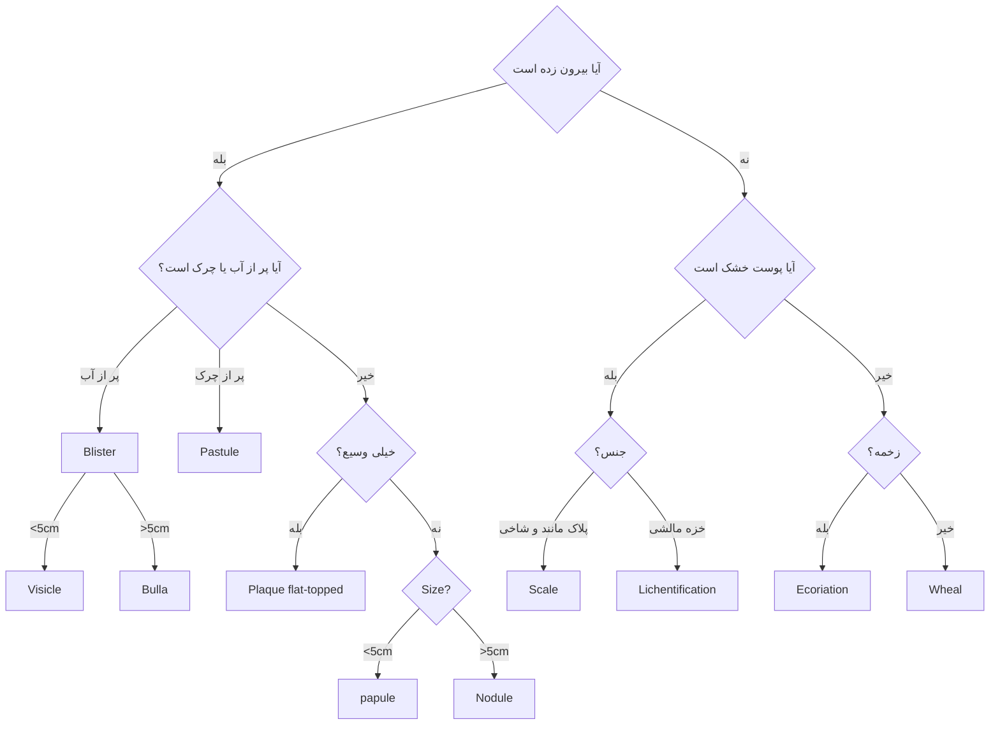

# پاتولوژی پوست

### ضایعات پوستی

**تشخیص افتراقی** : 

- پاپول و ندول هم dome-shaped هم flat-shaped ولی پلاک فقط flat.
- پچ و ماکول تفاوت رنگ دارن *(وگرنه که سطحشم یکیه اصن نمی فهمیدیم)*

### بیماری های حاد پوستی
- کلا اینا ==Mono nuclear==  دارن بر خلاف اکثر عفونت ها و التهاب های حاد بدن

|     بیماری      |                                                 هیستو                                                 |                              بالین                              |                      پاتوژنز                       |                                          ساب تایپ ها                                          |                 لام                  |
| :-------------: | :---------------------------------------------------------------------------------------------------: | :-------------------------------------------------------------: | :------------------------------------------------: | :-------------------------------------------------------------------------------------------: | :----------------------------------: |
|      کهیر       |    ==انفیلترای سطحی و پراکنده اطراف ورید== نوتروفیل نادر  گاهی ائوزینوفیل پراکندگی کلاژن     | ضایعات منفرد از پاپول تا پلاک ==خارش دار و متورم== Wheals | حساسیت تایپ 1 و اتصال IgE کمپلکس به Fc روی ماست سل | IgE-independent: افیون و آنتی بیوتیک  کهیر فشاری : فقط در نواحی تحت فشار (پا و باسن) | ![[Pasted image 20261104194106.png]] |
| درماتیت اگزمایی | اسپونژیوز انفیلترای سطحی لنفوسیتی  ادم پاپیلا های پوستی  ائوزینوفیل *مخصوصا در دارویی* |      پلاک های **خارش** دار، متورم، ترشح دار  آکانتوز      |                                                    |                                                                                               |                                      |
