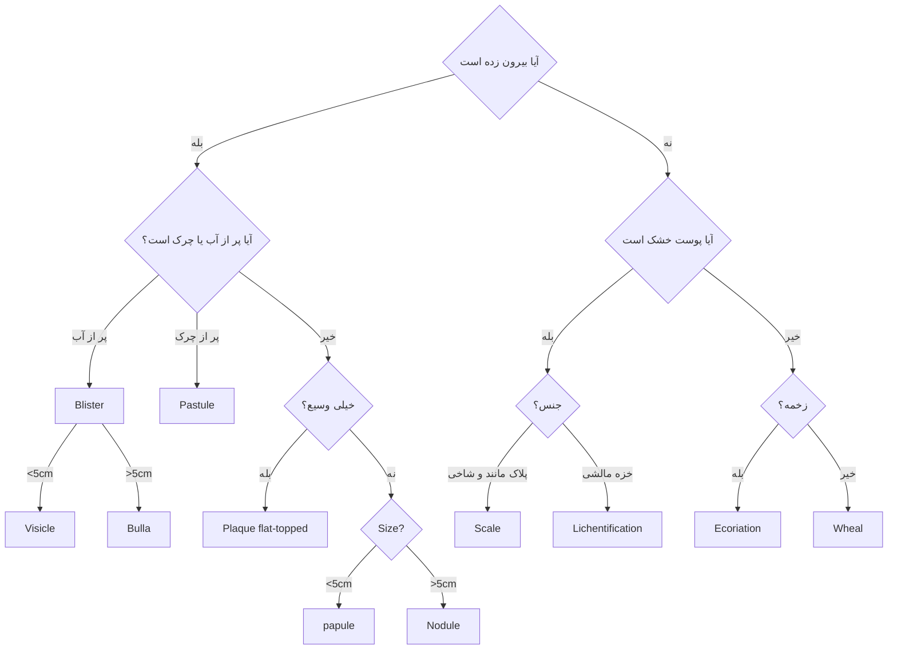

# پاتولوژی پوست

## ضایعات پوستی

**تشخیص افتراقی** : 

- پاپول و ندول هم dome-shaped هم flat-shaped ولی پلاک فقط flat.
- پچ و ماکول تفاوت رنگ دارن *(وگرنه که سطحشم یکیه اصن نمی فهمیدیم)*

## بیماری های حاد پوستی
- کلا اینا ==Mono nuclear==  دارن بر خلاف اکثر عفونت ها و التهاب های حاد بدن *لنفوسیتی ائوزینوفیلی*

|        بیماری         |                                                                      هیستو                                                                      |                                بالین                                 |                                          پاتوژنز                                           |                                          ساب تایپ ها                                          |                 لام                  |
| :-------------------: | :---------------------------------------------------------------------------------------------------------------------------------------------: | :------------------------------------------------------------------: | :----------------------------------------------------------------------------------------: | :-------------------------------------------------------------------------------------------: | :----------------------------------: |
|         کهیر          | ==انفیلترای سطحی و پراکنده اطراف ورید== نوتروفیل نادر  گاهی ائوزینوفیل پراکندگی کلاژن  ==ادم درم== *گفته بود ادم اپیدرم که غلطه* |   ضایعات منفرد از پاپول تا پلاک ==خارش دار و متورم== Wheals    |                     حساسیت تایپ 1 و اتصال IgE کمپلکس به Fc روی ماست سل                     | IgE-independent: افیون و آنتی بیوتیک  کهیر فشاری : فقط در نواحی تحت فشار (پا و باسن) | ![[Pasted image 20261104194106.jpg]] |
|    درماتیت اگزمایی    |     **اسپونژیوز در اپیدرم** انفیلترای سطحی لنفوسیتی  ادم پاپیلا های پوستی  ==ائوزینوفیل *مخصوصا در دارویی*== *Drug Eruption*     |     پلاک های **خارش** دار، متورم، ترشح دار $\leftarrow$ آکانتوز      |                                                                                            |                تماسی آلرژیک  آتوپیک دارویی نوری تحریک کننده اولیه                 | ![[Pasted image 20261105123740.jpg]] |
|   Atopic Dermatitis   |                                                                        "                                                                        |            اغلب در کودکی    ==**جهش فلاگرین**==             |                    تریاد اتوپیک:   $IgE\uparrow$ ، آسم و آلرژی غذایی                    |                                                                                               |                                      |
| درماتیت تماسی آلرژِیک |                                                                        "                                                                        |                  مثلا گردنش اگزما شده بخاطر گردنبند                  |     ماده حساسیت زا، داخل سلول ها نئوآنتی ژن تولید می کنه - T Cell آماده با این آنتی ژن     |                                                                                               |                                      |
|    اریتم مولتی فرم    |                    انفیلترای لنفوسیتی ==**اینترفیس درماتیت**==  کراتینوسیت های نکروتیک و ائوزینوفیل  ادم ادرمال                     | Targetoid lesions:  یک تاول کمرنگ یا نکروز در وسط و ماکول قرمز اطراف | $\leftarrow$  ==HSV== ویروس سلول های $CD8^+$ $\leftarrow$ حمله به سلول های بازال اپیدرم |                          عفونی و دارویی عفونی پروگنوز بهتری داره                           | ![[Pasted image 20261105144140.jpg]] |
### بیماری های کرونیک پوستی

- معمولا بخاطر اختلال در پوسته ریزی اپیدرم، پوست خشن میشه
- داخل اینا پراکراتوز ، آکانتوز، گرانولوز داریم
- انفیلترای درم فوقانی + عروق گشاد 

|            بیماری            |                                                                                                       هیستو                                                                                                        |                                                              بالین                                                              |                                                   پاتوژنز                                                    | ساب تایپ ها |                 لام                  |
| :--------------------------: | :----------------------------------------------------------------------------------------------------------------------------------------------------------------------------------------------------------------: | :-----------------------------------------------------------------------------------------------------------------------------: | :----------------------------------------------------------------------------------------------------------: | :---------: | :----------------------------------: |
|        **Psoriasis**         | 1. پاراکراتوز و اکانتوز  2. ==نوتروفیل های سطحی== : Munro - Kogoj *گفته بود لنفوسیت که غلط می شد*  3. عروق گشاد و مارپیچی :  Auspitz  4. نمای Rete (لوله آزمایشگاه) 5. پایپلا های نازک  |                                           پلاک های قرمز همراه پوسته های سفید نقره ای                                            | وجود Th1  - Th17در اپیدرم  التهاب مزمن و ریسک فاکتور CVI  ضربه باعث التهاب میشه (Koebner Effect) |      -      | ![[Pasted image 20261105145627.jpg]] |
|      **Lichen Planus**       |            1. ==**اینترفیس درماتیت**== با لنفوسیت غلیظ  2. Sawtooth Epiderm  3. Civatte cell 4. هایپرکراتوز، هایپرگرانولوز و اپیدرم  5.Squamitization : سلول های بازال زیادی بالغ             | پلاک و پاپول های بنفش چند ضلعی خارش دار با خطوط سفیدرنگ Wickham  در بزرگسالان، 70 درصد در مخاط دهان فقط با خطوط مشبک سفید |                سلول های $CD8^+$ $\leftarrow$ حمله به سلول های بازال $\leftarrow$ Civatte cell                |             | ![[Pasted image 20261105151017.jpg]] |
| **Lichen Simplex Chronicus** |                                              1. اکانتوز، هایپرگرانلوز، هایپرکراتوز  2. ==انفیلترای التهابی درم فوقانی== ، عروق گشاد و مارپیچی  3. رت زیاد                                              |                  ضایعات برجسته، قرمز و پوسته دار  Lichentification  اگر ندولار : prurigo nodularis                  |                                      پاسخ اداپتیو به تروما و اسکار شدنش                                      |             | ![[Pasted image 20261105151846.jpg]] |
### بیماری های عفونی پوستی

**ویژگی های کلی :** 
- نوتروفیل (لایه شاخی یا اپیدرم) *داخل سوریازیس هم بود*
- اسم های عجیب غریب برای زگیل

|      بیماری      |                                                                هیستو                                                                |                                                                                                      بالین                                                                                                       |                                                        پاتوژنز                                                         |            ساب تایپ ها             |                 لام                  |
| :--------------: | :---------------------------------------------------------------------------------------------------------------------------------: | :--------------------------------------------------------------------------------------------------------------------------------------------------------------------------------------------------------------: | :--------------------------------------------------------------------------------------------------------------------: | :--------------------------------: | :----------------------------------: |
|   **Impetigo**   |               ==انفیلترای نوتروفیلی در لایه شاخی== (میکروپاسچول های زیرشاخی)  التهاب درم و تغییرات غیر اختصاصی                |                                                     ضایعات سطحی قرمز با دلمه های زرد یا کلا زرد  بیشتر موارد از S. Areus و S.  Pyogenes  کودکان                                                      |                                                    عفونت پوست صرفا                                                     | نوع Bollus شبیه تاول های خود ایمنی | ![[Pasted image 20261105152921.jpg]] |
| **عفونت قارچی**  |                                                                                                                                     |                                                                                                                                                                                                                  |                                                                                                                        |                                    |                                      |
| عفونت قارچی سطحی |                                          ==انفیلترای نوتروفیل در اپی درم== *مثل سوریازیس*                                           |                                                              ضایعات قرمز-خاکستری خارش دار  و پوسته پوسته و حلقوی  گاهی شبیه سوریازیس و اگزما                                                               |                                                     کاندیدا و تینا                                                     |                                    | ![[Pasted image 20261105153343.jpg]] |
| عفونت قارچی عمقی |                        گرانولوماتوز  آسپرژیلوس : انژیوانویسیو  ==**PAS و Silver Methatoxate**==                         |                                                                                 ندول های قرمز رنگ و خارش دار، با احتمال خونریزی                                                                                  |                                                                                                                        |                                    |                                      |
|     **زگیل**     | هایپرپلازی اپیدرم موج دار  **کایلوسیتوز** : تجمعات ائوزینوفیلی داخل سیتوپلاسم سلول های آلوده  گرانول کاراتوهایلن برجسته | 1. Vulgaris : ==شایع ترین== به صورت پاپول های خاکستری پشت انگشت و روی دست  2. Plana : مسطح و روی صورت و پشت دست. ماکول قهوه ای روشن  3. Palmaris -Plantaris : کف پا و دست. ضایعات 1-2 سانتی شکل پینه | ==HPV==  معمولا گونه کم خطر، بازم E6 و E7 میسازه اما ریسک سرطان نداره  معمولا از تماس مستقیم ولی زود خوب میشه |          داخل بالین گفتم           | ![[Pasted image 20261105154347.jpg]] |
### تاول ها
- رسوب ها، آکانتولیز، دسموزوم، همی دسموزوم

|           بیماری           |                                                                  هیستو                                                                  |                                                              بالین                                                               |                                                        پاتوژنز                                                        |              شکل بالینی              |                 لام                  |
| :------------------------: | :-------------------------------------------------------------------------------------------------------------------------------------: | :------------------------------------------------------------------------------------------------------------------------------: | :-------------------------------------------------------------------------------------------------------------------: | :----------------------------------: | :----------------------------------: |
|          پمفیگوس           |                                        **==آکانتولیز==**  درم ائوزینوفیل، ماکروفاژ،مونوسیت                                        |                                                                                                                                  |                                        الگوی مشبک ==Fishnet== در رسوب های IgG                                         |                                      | ![[Pasted image 20261105173801.jpg]] |
|      پمفیگوس ولگاریس       |                                                       آکانتولیز در لایه **بازال**                                                       |       ==تاول های شل و سطحی(Superficial Flaccid)== در نواحی تحت فشار  دلمه سرمی که سریع هم چرکی میشه، بیشتر زنان مسن        |                                             خود ایمنی بر ==DSG1 و DSG3==                                              | ![[Pasted image 20261105173831.jpg]] | ![[Pasted image 20261105173914.jpg]] |
|      پمفیگوس فلوسئوم       |                                                     آکانتولیز در لایه **گرانولوزم**                                                     |                                    نادر تر و محدود به پوست ضایعات قرمز رنگ با دلمه و خفیف                                     |                                               خودایمنی فقط بر ==DSG1==                                                | ![[Pasted image 20261105173847.jpg]] | ![[Pasted image 20261105173925.jpg]] |
|    **بولوس پمفیگوئید**     |                   **ادم سطحی درم و واکوئوله شدن لایه بازال**  مقدار متغییری نوتروفیل و ائوزینوفیل در درم-اپیدرم                   |                 **Tensed bullea**  به راحتی پاره نمی شوند و مایع شفاف دارن. هی میره بر می گرده. بدون اسکال                 | الگوی ==خطی IgG== $\leftarrow$ فراخوانی نوتروفیل و ائوزینوفیل  خود ایمنی بر روی PBAG 1 , 2 و **همی دسموزوم ها** | ![[Pasted image 20261105174630.jpg]] | ![[Pasted image 20261105174641.jpg]] |
|   Gestational Pemphigoid   |                                                  هیچی، خیلی عالی فقط ممکنه عود کنه                                                   |                                                                                                                                  |                                                                                                                       | ![[Pasted image 20261105174743.jpg]] |                                      |
| **Herpetiform Dermatitis** | ابتدا نوتروفیل در نوک پاپیلا ها **==در درم==** *گفته بود کدوم در درمه، میشد همین*  سپس واکوالازیشن لایه بازال و تاول ساب اپیدرمال | تاول های ساب اپیدرمال در اکستانسور ها، بسیار خارش دار و در مردان مسن، با گلوتن  قرینه و دو طرفه  80% همراهی با سلیاک |                           ==رسوب گلوله ای IgA== در نوک پاپیلا ها (محل ==همی دسموزوم==)                             | ![[Pasted image 20261105175913.jpg]] | ![[Pasted image 20261105175926.jpg]] |
## تومور های پوستی

|          بیماری           |                                                                                   هیستو                                                                                    |                                                                                بالین                                                                                |                                                                                       پاتوژنز                                                                                       |                                  شکل بالینی                                  |                                   لام                                    |
| :-----------------------: | :------------------------------------------------------------------------------------------------------------------------------------------------------------------------: | :-----------------------------------------------------------------------------------------------------------------------------------------------------------------: | :---------------------------------------------------------------------------------------------------------------------------------------------------------------------------------: | :--------------------------------------------------------------------------: | :----------------------------------------------------------------------: |
|       کراتوز سبوریک       |                                             سلول های شبیه لایه بازال با ملانین  کیست های کراتینی و شبیه کیست های کراتینی                                             | پلاک های گرد برآمده با رنگ قهوه ای سیاه و پوشش مخملی  معمولا تنه گاهی اندام فوقانی  میتونه پارانئوپلاستیک بشه (Sign of lesser-trelat) کارسیونم روده  |                                                          ==FGFR3== $\rightarrow$ RAS & PI3K/AKT  حالت تیروزین کینازی                                                          |                     ![[Pasted image 20261105180840.jpg]]                     |                   ![[Pasted image 20261105180337.jpg]]                   |
|    **آکتینیک کراتوز**     | ==**آتیپی سیتولوژیک**== لایه‌های پایینی اپیدرم هایپرپلازی بازال یا آتروفی ==الاستوز خورشیدی== در درم پاراکراتوز در موارد نادر آتیپی تمام‌ضخامت SCC in situ  |                                  ضایعات معمولاً <1cm قهوه‌ای روشن یا قرمز بافتی زیر دارند نواحی در معرض آفتاب و پوست روشن                                  |                                                                ==UV== و جهش ==TP53== ضایعه ==**پیش‌سرطانی**==                                                                 |                     ![[Pasted image 20261105185025.jpg]]                     |                   ![[Pasted image 20261105185055.jpg]]                   |
| **کارسینوم سلول سنگفرشی** |           درجا: آتیپی تمام‌ضخامت اپیدرم  تهاجمی: جزایر یا لوبول‌های سلول سنگفرشی آتیپیک کراتینه شدن مرکزی و ==Keratin pearl==  دیسکراتوز و نکروز            | پلاک یا ندول هایپرکراتوتیک قرمز تا رنگ پوست گاهی زخمی  نواحی آفتابی و بزرگسالان مسن  پیش‌آگهی با ضخامت ==**Breslow زخم و میزان میتوز مرد غیر تنه**== | ==**UV**== جهش ==TP53== و ==RAS== جهش غیرفعال‌کننده ==Notch== سرکوب ایمنی ==HPV==، زخم مزمن یا سوختگی، آرسنیک  و پرتو یونیزان  خطر زیاد : Xeroderma Pigmentosa | ![[Pasted image 20261105190503.jpg\|72]]![[Pasted image 20261105190557.jpg]] | ![[Pasted image 20261105190525.jpg]]![[Pasted image 20261105190630.jpg]] |
|  **کارسینوم سلول بازال**  | رشد چند کانونه اپیدرم   جزایر یا رشته‌های سلول بازوفیلیک با هسته هایپرکروماتیک  ==**پالیسادینگ**== محیطی ==شکاف== از استروما استرومای فیبروتیک یا موکسین |                 پاپول یا ندول برجسته با حاشیه نامنظم  و تلانژکتازی گاهی زخم یا پیگمانته ==شایع‌ترین== سرطان پوست رشد آهسته و متاستاز نادر                  |              جهش فعال‌کننده ==PTCH1== و مسیر ==Hedgehog==  سندرم گورلین : ==آتوزومال غالب== با مدولوبلاستوما و تومور های فک  معمترین ریسک فاکنور : **UV**               |                     ![[Pasted image 20261105191308.jpg]]                     |                   ![[Pasted image 20261105191327.jpg]]                   |
### تومور های رنگدانه

|       بیماری       |                                                                                                                             هیستو                                                                                                                             |                                                                    بالین                                                                    |                                                                                                         پاتوژنز                                                                                                         |              شکل بالینی              |                  لام                  |
| :----------------: | :-----------------------------------------------------------------------------------------------------------------------------------------------------------------------------------------------------------------------------------------------------------: | :-----------------------------------------------------------------------------------------------------------------------------------------: | :---------------------------------------------------------------------------------------------------------------------------------------------------------------------------------------------------------------------: | :----------------------------------: | :-----------------------------------: |
| **خال ملانوسیتی**  |                                              سلول های سطحی بزرگ، خوشه ای و ملانین دار  سلول های عمقی، رشته ای کوچک، بدون رنگدانه و دوکی  نوع Junctional : مرز درم و اپی درم، هسته های نامنظم توده ای                                              |                                 ماکول یا پاپول قهوه‌ای روشن تا تیره یکنواخت معمولاً <5mm با حاشیه گرد                                 |                                                                             جهش‌های فعال‌کننده ==BRAF== یا ==RAS== فعال‌سازی اولیه تکثیر                                                                             | ![[Pasted image 20261105192237.jpg]] | ![[Pasted image 20261105192251.jpg]]  |
| **خال دیسپلاستیک** |                                                    compound ==**hyperplasia lentiginous**== nests نامنظم یا بریجینگ آتیپی هسته‌ای ==فیبروز لاملار== ارتشاح لنفوسیتی و ==بی‌اختیاری ملانین==                                                    | معمولاً >5mm ماکول یا پلاک کمی برجسته با سطح pebbly رنگدانه و حاشیه نامنظم و تعداد بالا در نوع فامیلی خطر بالای ملانوما ==(100%)== |                                                              جهش BRAF یا RAS نشانگر خطر ملانوما، نه لزوماً ضایعه پیش‌بدخیم  بیشتر از 10 تا خطرناک                                                              | ![[Pasted image 20261105192317.jpg]] | -![[Pasted image 20261105192419.jpg]] |
|    **ملانوما**     | تکثیر مزانوسیت‌های آتیپیک رشد شعاعی و سپس رشد عمودی یا ندولار فقدان بلوغ، میتوز و آنیوپلوئیدی  توده های نامنظم یا سلول های پراکنده در اپیدرم و درم به صورت ندول های حجیم   ارتشاح لنفوسیتی  کروماتین چسبیده به غشا و هستک قرمز گیلاسی |    ضایعه پیگمانته نامتقارن با حاشیه نامنظم رنگ متغیر، قطر >6mm و تغییر علائم  ==ABCs==  ==آکرال ملانوما در سیاه پوستان==     | ==UV== ==BRAF== CDKN2A/p16 تلومراز ==TP53== و  ==PTEN==  غیرآفتابی : فعال کننده ==Kit== و GN برای چشم   9p21 in ==40%== of familial  قرار گرفتن ==متناوب، شدید و درکودکی== در آفتاب | ![[Pasted image 20261105193538.jpg]] | ![[Pasted image 20261105193513.jpg]]  |
